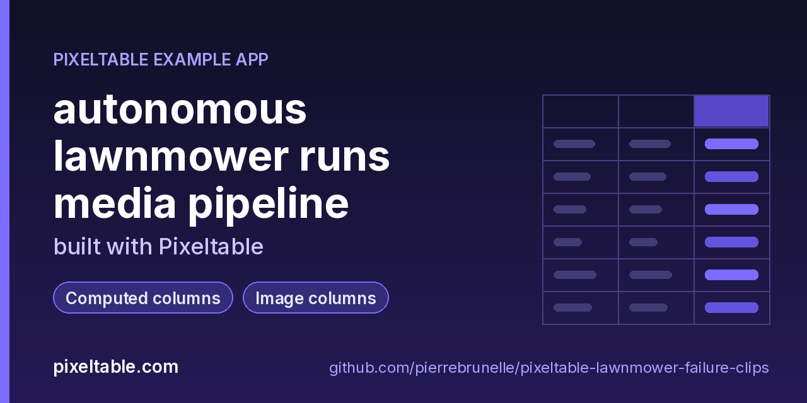

<!-- pixeltable-example-app: 20261112-lawnmower-failure-clips -->
# Mine similar failure clips from robot videos in Python

Insert each robot run's video into a Pixeltable table. A video_splitter view cuts it into fixed-length clips, a computed column pulls a keyframe from every clip, and a CLIP embedding index on the keyframes lets you rank clips by a text description ("an orange hose across the grass") or by an example failure frame. New runs are processed incrementally on insert; no export step, no separate vector store.

**Replaces:** Rerun/Foxglove exports + FAISS notebooks



[](https://codespaces.new/pierrebrunelle/pixeltable-lawnmower-failure-clips?quickstart=1)
[](https://pixeltable.com)
[](https://pypi.org/project/pixeltable/)
[](https://github.com/pixeltable/pixeltable)
[](LICENSE)

A small robot-mower fleet uploads one front-camera video per mowing run. This Pixeltable media pipeline stores the runs, splits every video into fixed 3-second clips with video_splitter, extracts a keyframe per clip, labels the obvious failures (hose snag, tipping on a slope, stalling in the dark, fence bump) with cheap color rules, and indexes each keyframe with CLIP so you can find look-alike failure clips by text or by example frame. A truncated upload and a run with no recording are stored with per-cell errors instead of failing the batch. The schema evolves in three steps with pxt schema diff/update, including an iterator change.

[Pixeltable](https://pixeltable.com) is open-source, Python-native **multimodal AI data infrastructure**: tables, incremental computed columns, UDFs, indexes and serving in one library, running locally or on Pixeltable Cloud.

> ⭐ **Like this example?** Star [pixeltable/pixeltable](https://github.com/pixeltable/pixeltable) on GitHub. It helps other developers find it.

## What this example shows

- **Incremental computed columns** powered by plain Python UDFs (`@pxt.udf`)
- **Multimodal media columns** with configurable media destinations
- **Importable UDF module**: UDFs live in `udfs.py`; tables and queries live in `app.py` (Pixeltable resolves UDFs by module path)
- **`pixeltable.toml`** declares a local database and a **Pixeltable Cloud** database, so the same code deploys with `pxt db update`


## What's inside

| File | What it is |
|------|------------|
| `.devcontainer/devcontainer.json` | GitHub Codespaces / Dev Container config: Python 3.12, installs `requirements.txt` |
| `.github/social-preview.png` | Social preview image (1280x640) |
| `CITATION.cff` | Citation metadata (authors, license, release date, keywords) |
| `app.py` | Tables declared as Python classes and `@pxt.query` functions |
| `data/runs/MW-101.mp4` | Sample data |
| `data/runs/MW-102.mp4` | Sample data |
| `data/runs/MW-103.mp4` | Sample data |
| `data/runs/MW-104.mp4` | Sample data |
| `data/runs/MW-105.mp4` | Sample data |
| `data/runs/MW-106.mp4` | Sample data |
| `make_videos.py` | Generate small synthetic mower-camera videos with ffmpeg (offline, ~1 MB total) |
| `pixeltable.toml` | Project config: the local database plus a Pixeltable Cloud database (sizing, deploy excludes) |
| `run.py` | Drive the mower failure-clip pipeline: ingest runs, label clips, mine look-alikes |
| `udfs.py` | Pixeltable UDFs (`@pxt.udf`) in their own importable module, imported by `app.py` |
| `requirements.txt` / `pyproject.toml` | Dependencies (`pixeltable>=0.7.24`) |

**Tables**

| Table | Stored columns | Computed columns |
|-------|---------|------------------|
| `runs` | `run_id`, `mower`, `yard`, `video`, `firmware` | `run_secs`, `fw_family` |
| `clips` | - | `keyframe`, `brightness`, `shares`, `label`, `thumb`, `review` |

## Run in your browser (GitHub Codespaces)

[](https://codespaces.new/pierrebrunelle/pixeltable-lawnmower-failure-clips?quickstart=1)

1. Click **Open in GitHub Codespaces** above (or [this link](https://codespaces.new/pierrebrunelle/pixeltable-lawnmower-failure-clips?quickstart=1)). The dev container installs Python 3.12 and `pixeltable>=0.7.24` from `requirements.txt`.
2. In the codespace terminal, create the tables, seed them and run the app:

   ```bash
   pxt schema update app.py mower
   python make_videos.py  # 5 synthetic mower runs + 1 truncated upload (needs ffmpeg)
   pxt schema update app.py mower
   python run.py  # ingest runs, print the clip report and the look-alike searches
   python run.py --report --mine
   ```


## Quickstart

Requires Python 3.11+ and `pixeltable>=0.7.24`.

```bash
git clone https://github.com/pierrebrunelle/pixeltable-lawnmower-failure-clips.git
cd pixeltable-lawnmower-failure-clips
python -m venv .venv && source .venv/bin/activate
pip install -r requirements.txt

# Create the tables in a local catalog directory named `mower`
pxt schema update app.py mower

python make_videos.py  # 5 synthetic mower runs + 1 truncated upload (needs ffmpeg)
pxt schema update app.py mower
python run.py  # ingest runs, print the clip report and the look-alike searches
python run.py --report --mine
```

## Deploy to Pixeltable Cloud

The same `app.py` runs on [Pixeltable Cloud](https://pixeltable.com). Sign in (or get a free trial database with `pxt new`), point the second database entry in `pixeltable.toml` at your own database, then deploy:

```bash
pxt login                       # or: export PIXELTABLE_API_KEY=<your-api-key>
# edit pixeltable.toml: name = 'pxt://<your-org>:<your-db>'
pxt db update pxt://<your-org>:<your-db>                 # build the image and upload the project
pxt schema update app.py pxt://<your-org>:<your-db>       # create the tables at the database root (no per-app folder)
```

Keep keys in environment variables or `pxt secret set`, never in code.

## Code walkthrough

**1. Business logic is plain Python, in `udfs.py`.** A `@pxt.udf` function can be used as a column expression. Pixeltable records UDFs by module path (`udfs.luma`), so they live in their own importable module rather than inline in the app: the daemon, serving workers and Pixeltable Cloud import it again by that path.

```python
# udfs.py
@pxt.udf
def luma(img: PIL.Image.Image) -> float:
    """Mean brightness (0..255) of a frame."""
    return float(np.asarray(img.convert('L'), dtype=np.float32).mean())
```

**2. Tables are Python classes (`app.py`).** Annotated attributes are stored columns; attributes assigned an expression are **computed columns** (`keyframe`, `brightness`, `shares`, `label`, `thumb`, `review`), evaluated incrementally on every insert or update and recomputed when their inputs change. Indexes live next to the columns.

```python
# app.py
class Clips(
    TableModel,
    name='clips',
    base=Runs,
    iterator=pxtf.video.video_splitter(Runs.video, duration=3.0, min_segment_duration=1.0),
):
    """Fixed 3-second clips of every run, each with a keyframe, a rule label and a CLIP embedding."""

    keyframe = pxtf.video.extract_frame(video_segment, timestamp=1.5)  # type: ignore[name-defined]  # noqa: F821
    brightness = luma(keyframe)
    shares = color_shares(keyframe)
    label = failure_label(shares, brightness)
    thumb = gray_thumb(keyframe)  # mode 'L'
    review = overlay_mask(keyframe, label)  # RGBA tint on failure clips
    clip_secs = segment_end - segment_start  # type: ignore[name-defined]  # noqa: F821

    __indexes__ = [pxt.EmbeddingIndex(keyframe, embedding=CLIP, name='keyframe_clip')]
```

**3. Queries are functions (`app.py`).** `@pxt.query` wraps a Pixeltable query so it can be called from Python or exposed as a route:

```python
# app.py
@pxt.query
def failure_queue(label: str):
    """Clips the rules flagged with a given failure label, in run order."""
    return (
        Clips.where(Clips.label == label)
        .order_by(Clips.run_id, Clips.segment_start)
        .select(Clips.run_id, Clips.yard, Clips.segment_start, Clips.segment_end, Clips.brightness)
    )
```

## FAQ

**How are robot videos split into clips?**

Clips is a view over Runs with iterator=video_splitter(Runs.video, duration=3.0, min_segment_duration=1.0). Each row is one clip with segment_start, segment_end and its own video_segment file; extract_frame(video_segment, timestamp=1.5) adds a keyframe column.

**How do I find clips similar to a known failure?**

The keyframe column has a CLIP EmbeddingIndex (openai/clip-vit-base-patch32). Order by clips.keyframe.similarity(image=example_frame) for look-alikes of a flagged frame, or similarity(string='...') to search by description. python run.py --report --mine runs both.

**What happens with a corrupt or missing video?**

Inserts use on_error='ignore': a truncated upload is stored with an error on its video cell (inspect it with runs.video.errortype / errormsg) and produces no clips; a run without a recording has a null video and simply has no clip rows. The other runs in the batch are unaffected.

**Can I change the clip length later?**

Adding columns or indexes is an in-place pxt schema update. Changing the iterator (here 4 s to 3 s clips) is reported as UNSUPPORTED by pxt schema diff, so drop the view (pxt drop mower/clips -f) and run pxt schema update again; the clips, keyframes and embeddings are recomputed from the stored runs.

**Does it need a GPU or an API key?**

No. CLIP runs on CPU for a handful of keyframes, the labels are pure-Python color rules, and the sample videos are generated offline with ffmpeg by make_videos.py.

## Learn more

- 🌐 Website: https://pixeltable.com
- 📚 Docs: https://docs.pixeltable.com
- 💻 Source: https://github.com/pixeltable/pixeltable (⭐ star it if Pixeltable is useful to you)
- 📦 PyPI: https://pypi.org/project/pixeltable/
- 🧩 More example apps: https://pierrebrunelle.github.io/awesome-pixeltable-apps/

**[More Pixeltable example apps →](https://pierrebrunelle.github.io/awesome-pixeltable-apps/)**

---

<sub>Built as part of a daily series of Pixeltable example apps · Pixeltable 0.7.24 · Python, incremental computed columns · Licensed under Apache-2.0.</sub>
